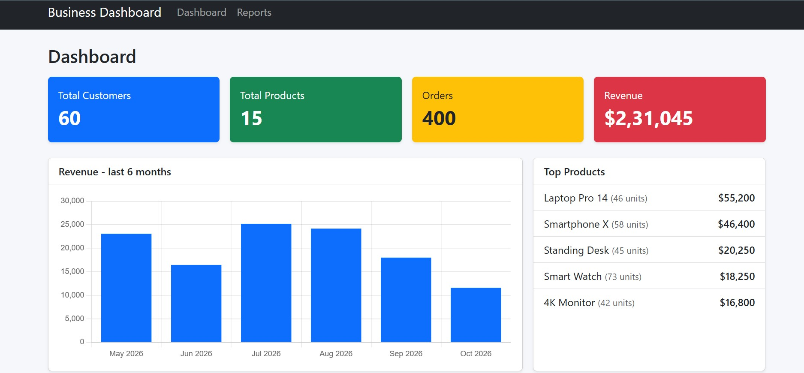
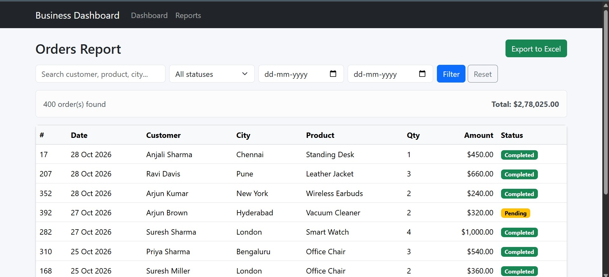

# Business Dashboard

A sales analytics dashboard built with ASP.NET Core MVC. It shows key business numbers, a monthly revenue chart, top selling products and an orders report.

## Features
- Summary cards: total customers, products, orders and revenue
- Revenue chart for the last 6 months
- Top selling products with units sold
- Orders report with status (Completed, Shipped, Pending, Cancelled)

## Tech Stack
- ASP.NET Core 8 MVC
- Entity Framework Core
- SQL Server LocalDB
- Bootstrap 5

## Screenshots
### Dashboard

### Reports

## How to Run
1. Install the [.NET 8 SDK](https://dotnet.microsoft.com/download) and SQL Server LocalDB (comes with Visual Studio)
2. Open a terminal in this folder and run:

        dotnet run

3. Open the URL shown in the terminal (for example http://localhost:5000)

The database and sample data are created automatically on first run. No manual setup needed.
